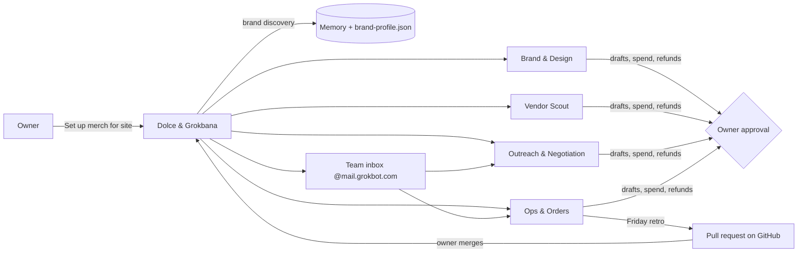

# Dolce & Grokbana

**Install one Grok Bot, give it your company's website, and it builds a 4-bot team that runs your merch end to end. Nothing ships, sends or spends without your OK.**

Team 4 entry, Galatiq x SpaceXSI Grok Bot Hackathon, Austin, Oct 19 2026.

## How it works
1. Install **Dolce & Grokbana** and say *"Set up merch for galatiq.ai"* (or "Build my team").
2. It claims the team's own `@mail.grokbot.com` inbox, reads the brand from the site (palette, voice, wordmark, every fact sourced), and saves it to memory.
3. It creates 4 sub-bots with their skills and paused routines.
4. Customers and vendors email the team inbox. Replies are drafts the owner approves.
5. Every Friday the retro turns 👎 feedback into a pull request on this repo. The owner merges, and every install picks it up through **Repo sync**.

## The team
| Bot | Job | Skills | Routines (all start paused) |
|---|---|---|---|
| Dolce & Grokbana | Installs and maintains the team | `merch-team-setup` | Repo sync, daily 9:03 AM |
| Brand & Design | Brand profile, mockups, tech packs, approval queue | Merch · Brand brief, Merch · Mockups | Daily merch brief, weekdays 8:07 AM |
| Vendor Scout | Compares print shops at 25/50/100 units, never contacts vendors | Merch · Vendor comparison | Vendor refresh, Wed 10:17 AM |
| Outreach & Negotiation | Drafts quote requests and counteroffers | Merch · Quote request, Merch · Negotiation playbook | Vendor thread check, weekdays 11:12 AM |
| Ops & Orders | POs, test-mode deposits, order list, late/missed orders, shipping, tracking, reships, customer replies, retro | Merch · Purchase order, Merch · Customer reply, Merch · Weekly retro | Customer replies (on new mail), Weekly retro Fri 4:17 PM |

## Rules (in every bot)
- Every customer and vendor message is a draft the owner approves.
- **Hard $500 limit:** anything over $500, one order or a day's total, is blocked outright and never split.
- Spend, refunds, discounts, credits, new vendors, public logo use and image generations go to the owner first.
- Payments run in Stripe test mode only. No customer personal info in skills. Never claim the brand endorses the merch.

## Plugins
Gmail or Outlook, Google Drive, Higgsfield (mockups), Adapter (optional, id 70141458). The browser is the fallback.

## Collaborate
Edit `bot-team/merch-team-setup/skills/merch-team-setup/SKILL.md` in a pull request to `dolce-and-grokbana`. Installed bots apply changes only after the owner says yes.

## Worked example
Galatiq (`bot-team/verticals/clothing-brand/examples/galatiq/`): sourced brand profile, mockups, vendor comparison, quote request, and a purchase order flagged "Over $500, needs owner". All drafts, nothing ordered.
